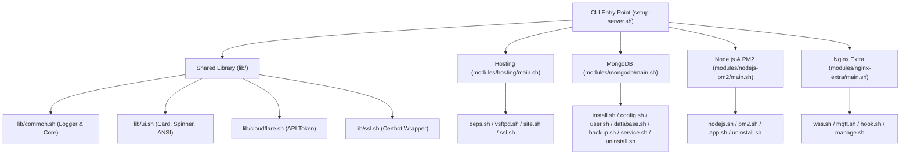

# Route Map — Script Setup Server

> Sumber kebenaran tunggal untuk arsitektur, struktur modular, dan pohon menu panel server.
> **Wajib diperbarui setiap kali ada perubahan menu/alur.** Sesuai pedoman `.agent/rules/11-format-dokumentasi.md`.

---

## 1.1 Arsitektur Umum

`script-setup-server` adalah antarmuka CLI interaktif berbasis Bash untuk automasi deployment, konfigurasi, dan manajemen server Ubuntu/Debian (VPS / Bare-Metal). Sistem mengintegrasikan empat domain layanan server utama: Web Hosting (Nginx, VSFTPD, Let's Encrypt SSL via Certbot/Cloudflare), Database (MongoDB multi-version & WiredTiger tuning), Runtime Aplikasi (Node.js LTS & PM2 process manager), dan Jaringan Ekstra (WebSocket Proxy & MQTT over TLS).

Arsitektur sistem dibangun dengan pola *modular domain dispatcher*. Entry point tunggal `setup-server.sh` bertindak sebagai slim router yang memuat shared core library (`lib/`), lalu mendelegasikan alur ke controller domain masing-masing (`modules/<domain>/main.sh`). Masing-masing domain dipecah menjadi submodul terfokus (< 350 baris per file) dengan enkapsulasi variabel lokal (`local`) untuk mencegah tabrakan *global scope*.



> **Catatan API Spec:** Project ini adalah perkakas automasi CLI lokal (bukan web server REST API), sehingga file `docs/api-spec.md` ditiadakan sesuai pedoman `.agent/rules/11-format-dokumentasi.md` Bagian 2.

---

## 1.2 Struktur Folder

```
script-setup-server/
├── setup-server.sh              # Entry point utama (Panel Terpadu)
├── setup-hosting.sh             # Backward-compatible shim -> modules/hosting/main.sh
├── mongodb-manager.sh           # Backward-compatible shim -> modules/mongodb/main.sh
├── nodejs-pm2-manager.sh        # Backward-compatible shim -> modules/nodejs-pm2/main.sh
├── install.sh                   # One-line installer online (curl | sudo bash)
│
├── lib/                         # Shared libraries (dimuat oleh modul)
│   ├── common.sh                # Core loggers, helpers, validasi OS
│   ├── ui.sh                    # Modern UI helpers (single-line spinner, card, ANSI 256)
│   ├── cloudflare.sh            # Credential manager Cloudflare API
│   └── ssl.sh                   # Deteksi dan instalasi sertifikat Let's Encrypt
│
├── modules/                     # Domain modules (arsitektur modular terdistribusi)
│   ├── hosting/                 # Domain Web Hosting, Nginx Vhost, VSFTPD, SSL
│   │   ├── main.sh              # Router menu hosting
│   │   ├── deps.sh              # Cek & install paket dependensi hosting
│   │   ├── vsftpd.sh            # Konfigurasi vsftpd & port pasv
│   │   ├── site.sh              # Create, delete, modify website & FTP deploy user
│   │   └── ssl.sh               # Manajemen SSL certbot Cloudflare DNS / HTTP-01
│   │
│   ├── mongodb/                 # Domain Database MongoDB
│   │   ├── main.sh              # Router menu MongoDB
│   │   ├── install.sh           # Repositori APT & setup versi MongoDB
│   │   ├── config.sh            # Konfigurasi /etc/mongod.conf, port, auth, TLS
│   │   ├── user.sh              # User management & RBAC MongoDB
│   │   ├── database.sh          # Database & Collection management
│   │   ├── backup.sh            # Backup (tar.gz) & Restore mongorestore
│   │   ├── service.sh           # Systemd service lifecycle & log viewer
│   │   └── uninstall.sh         # Purge total paket & konfigurasi MongoDB
│   │
│   ├── nodejs-pm2/              # Domain Runtime Node.js & Process Manager PM2
│   │   ├── main.sh              # Router menu Node.js & PM2
│   │   ├── nodejs.sh            # NodeSource & NVM installation / upgrade
│   │   ├── pm2.sh               # Instalasi PM2 & systemd startup generator
│   │   ├── app.sh               # Lifecycle aplikasi PM2 (start, stop, reload, delete, monit)
│   │   └── uninstall.sh         # Purge total Node.js & PM2
│   │
│   └── nginx-extra/             # Domain Layanan Ekstra Jaringan
│       ├── main.sh              # Router menu Nginx Extra
│       ├── wss.sh               # WebSocket Reverse Proxy (existing / custom vhost)
│       ├── mqtt.sh              # MQTT over TLS Stream Proxy (TCP stream block)
│       ├── hook.sh              # Certbot auto-renew deploy-hook
│       └── manage.sh            # List & cleanup konfigurasi stream / proxy
│
└── docs/                        # Dokumentasi resmi proyek (Single Source of Truth)
    ├── route-map.md             # Pohon menu dan arsitektur sistem
    ├── CHANGELOG.md             # Riwayat rilis dan perubahan
    ├── technical-architecture-blueprint.md # Blueprint arsitektur modular teknis
    ├── cli-ux-specification.md  # Spesifikasi standar desain UI/UX CLI
    ├── requirements-refactor-besar.md      # Spesifikasi requirement refactor
    └── adr/                     # Architecture Decision Records
        └── ADR-001-modularisasi-script-setup-server.md
```

---

## 1.3 Peta Route / Navigasi (Pohon Menu CLI)

```
setup-server (Panel Terpadu)
|
|-- 1. Hosting Panel                       -> modules/hosting/main.sh (hosting_main)
|     |-- 1. Cek & Install Dependensi      (vsftpd, nginx, certbot, acl, openssl, ufw, dns-cloudflare)
|     |-- 2. Setup Cloudflare API Token    -> lib/cloudflare.sh (setup_cloudflare_creds)
|     |-- 3. Konfigurasi vsftpd Server     (sekali saja: port, pasv, FTPS, pasv_address)
|     |-- 4. Manage Website & FTP
|     |     |-- 1. Buat Website + FTP baru (folder fe/api, deploy user, Nginx, SSL)
|     |     |-- 2. Buat FTP saja (tanpa Website)
|     |     |-- 3. Hapus Website & FTP
|     |     |-- 4. Ubah Password FTP
|     |     +-- 5. Kembali
|     |-- 5. Manage SSL
|     |     |-- 1. List & Detail Sertifikat
|     |     |-- 2. Buat Sertifikat Baru    (Cloudflare DNS / HTTP-01, wildcard)
|     |     |-- 3. Renew Sertifikat        (semua / tertentu / dry-run)
|     |     +-- 4. Kembali
|     +-- 6. Keluar
|
|-- 2. MongoDB Manager                     -> modules/mongodb/main.sh (mongodb_main)
|     |-- 1. Setup MongoDB                 (versi 6.0/7.0/8.0, port, auth, bind, cache WiredTiger, replica set, TLS)
|     |-- 2. Manage User
|     |     |-- 1. Buat user baru
|     |     |-- 2. Update user (password & role)
|     |     |-- 3. Reset password
|     |     |-- 4. Hapus user
|     |     |-- 5. Ganti role
|     |     +-- 6. Kembali
|     |-- 3. Manage Database
|     |     |-- 1. Lihat collections dalam database
|     |     |-- 2. Buat database baru
|     |     |-- 3. Hapus database
|     |     |-- 4. Buat collection baru
|     |     |-- 5. Hapus collection
|     |     +-- 6. Kembali
|     |-- 4. Backup database               (mongodump + kompres .tar.gz)
|     |-- 5. Restore database              (mongorestore dari .tar.gz/direktori)
|     |-- 6. Service MongoDB
|     |     |-- 1. Lihat log terbaru (50 baris)
|     |     |-- 2. Start
|     |     |-- 3. Stop
|     |     |-- 4. Restart
|     |     |-- 5. Reload konfigurasi
|     |     |-- 6. Perbaiki masalah konfigurasi umum (keyFile & TLS)
|     |     +-- 7. Kembali
|     |-- 7. Hapus/Uninstall MongoDB      (package, config, repo APT; data opsional)
|     +-- 8. Keluar
|
|-- 3. Node.js & PM2                       -> modules/nodejs-pm2/main.sh (nodejs_pm2_main)
|     |-- 1. Install / Reinstall Node.js   (18 / 20 / 22)
|     |-- 2. Install / Reinstall PM2
|     |-- 3. Update Node.js
|     |-- 4. Update PM2 & Process
|     |-- 5. Status Node.js & PM2
|     |-- 6. Manage Aplikasi (PM2)
|     |     |-- 1. Start aplikasi baru
|     |     |-- 2. Stop aplikasi
|     |     |-- 3. Restart aplikasi
|     |     |-- 4. Delete aplikasi dari PM2
|     |     |-- 5. Lihat log aplikasi
|     |     |-- 6. Lihat detail aplikasi (monit)
|     |     |-- 7. Simpan daftar aplikasi (pm2 save)
|     |     +-- 8. Kembali
|     |-- 7. Konfigurasi
|     |     |-- 1. Pilih versi Node.js default
|     |     |-- 2. Setup alias/shortcut
|     |     |-- 3. Setup PM2 startup (systemd)
|     |     |-- 4. Hapus Node.js & PM2 (uninstall total)
|     |     +-- 5. Kembali
|     +-- 8. Keluar
|
|-- 4. Nginx Extra                         -> modules/nginx-extra/main.sh (nginx_extra_main)
|     |-- 1. Setup WSS Reverse Proxy
|     |     |-- [1] Domain existing        (sisip location WSS, default path /ws, port 3001)
|     |     +-- [2] Domain khusus baru      (server block 80->443, default path /, port 3001)
|     |-- 2. Setup MQTT TLS                (Nginx stream: mqtts 8883 -> broker plain 127.0.0.1:1883)
|     |-- 3. Setup/Refresh Auto-Renew Hook (deploy-hook reload nginx & mosquitto)
|     |-- 4. List Konfigurasi
|     |-- 5. Hapus Konfigurasi             ([1] stream MQTT / [2] site WSS)
|     +-- 6. Kembali
|
+-- 5. Keluar
```

---

## 1.4 Konvensi Penamaan

- **Folder Domain**: Disimpan di `modules/<nama-domain>/` (misal: `hosting`, `mongodb`, `nodejs-pm2`, `nginx-extra`).
- **Entry Point Modul**: Setiap folder modul memiliki `main.sh` sebagai controller menu utama yang mengekspor fungsi `<domain>_main`.
- **Submodul Per-Tanggung Jawab**: File dipecah berdasarkan concern fungsional (`deps.sh`, `site.sh`, `install.sh`, `service.sh`). Ukuran file maksimum 350 baris, fungsi individual maksimum 50 baris.
- **Variabel & Scoping**: Seluruh variabel internal dalam fungsi dideklarasikan dengan `local` (misal: `local var_name=""`). Variabel environment global yang dibagikan antarmodul diawali dengan huruf besar (misal: `ROOT_DIR`).
- **Guard Sourcing**: Setiap modul menyertakan guard `if [[ "${BASH_SOURCE[0]}" == "${0}" ]]; then` agar file aman di-source tanpa auto-eksekusi liar saat diimpor oleh modul lain.

---

## 1.5 Dependency Utama

| Paket / Tool | Fungsi dalam Sistem |
|---|---|
| **Nginx** (`nginx`) | Web server reverse proxy, HTTP-01 challenge handler, SSL terminator, WSS & TCP stream MQTT. |
| **vsftpd** (`vsftpd`) | FTP server terisolasi (chroot jail) dengan dukungan FTPS untuk deploy user. |
| **Certbot** (`certbot`) | Automasi request dan auto-renewal sertifikat Let's Encrypt SSL/TLS. |
| **python3-certbot-dns-cloudflare** | Plugin Certbot untuk autentikasi DNS-01 challenge (wildcard certificate). |
| **MongoDB** (`mongodb-org`) | Database NoSQL dokumen; konfigurasi WiredTiger cache, mongod daemon, replica set, TLS. |
| **Node.js & NPM** | Runtime JavaScript server-side via official NodeSource APT repository. |
| **PM2** | Production process manager untuk aplikasi Node.js (cluster mode, systemd startup). |
| **OpenSSL** (`openssl`) | Pembuatan DHParam, self-signed certificate, dan verifikasi chain sertifikat. |
| **ACL** (`acl` / `setfacl`) | Fine-grained file permission untuk integrasi user www-data dan FTP deployer. |
| **UFW** (`ufw`) | Manajemen aturan firewall port layanan server (20-21, 80, 443, 27017, 8883, pasv ports). |
